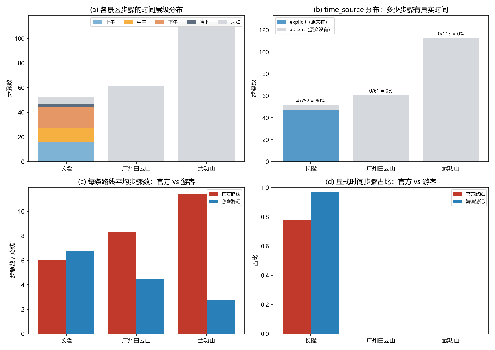

# 项目 3 实验报告 · 游览路线的层级结构挖掘

> 负责人：HappinessJo｜复核：T0coke
> 数据版本：`v0.1-p01`（三景区 29 篇 `clean_content`）｜交付 tag：`v0.3-p03`
> 复现命令：`python analysis/p03_routes/src/run_all.py`（解析 → 层级/对比/图 → 自检，退出码 0）
> 文中所有数字来自 `outputs/hierarchy.json` 与 `outputs/compare_official_vs_user.csv`，均由脚本生成，未手写。

---

## 1. 任务与产出

把官方攻略与游客游记中的路线描述解析成统一结构（步骤序号 / 时间 / 景点 / 活动），再按**上午 / 中午 / 下午**建时间层级，附加题做**官方 vs 游客**对比。

| 产出 | 路径 | 规模 / 说明 |
|---|---|---|
| 路线步骤 | `outputs/routes.jsonl` | **35 条路线 / 226 个步骤**，一行一步 |
| 时间层级 | `outputs/hierarchy.json` | 4 类时段 + 未知，含逐路线明细与口径 |
| 结构图 | `outputs/figures/route_structure.png` | 4 面板：(a) 时段分布 (b) 时间来源 (c) 每路线步数 (d) 显式时间占比 |
| 官方 vs 游客 | `outputs/compare_official_vs_user.csv` | 3 景区 + 合计，18 个指标 |
| 名称归一化 | `config/alias.csv` | 150 条映射（简称/全称/别名/子景点） |
| 脚本 | `src/parse_routes.py`、`build_hierarchy.py`、`run_all.py` | 一条命令重跑，输出确定性（重跑哈希一致） |
| 自检 | `python checks/check_routes.py` | 退出码 0 |

---

## 2. 输入与数据观察

三份 `*_guides.csv` 的 `clean_content`（只读）。逐篇阅读后发现**同一任务有 6 种书写形态**，这是解析设计的出发点：

| 形态 | 例子 | 文档 |
|---|---|---|
| 箭头/破折号链路 | `北门——小火车游览区——青龙山——…`；`石鼓寺--尽心桥--飙水岩瀑布`；`南门→能仁寺→蒲谷` | CL-O-02、WGS-O-01/02/05、BYS-T-02/03、WGS-T-05 |
| 编号站（可带时刻） | `第一站（10:00）：小火车游览` | CL-O-02、CL-O-01 |
| 时间开头行 | `09:00 入园 / 安检入口`；`9:00-12:00 刺激项目黄金时段` | CL-T-01/02/03 |
| 时段小标题 | `上午——尖叫地带` / `中午：椰林餐厅+嘉年华` | CL-O-03、CL-T-04 |
| 天数分段 | `D1：` / `DAY-1` / `第2天` | WGS-O-03/04/05 |
| 枚举式 | `首先步行游览麓湖公园、鸿鹄楼、聚芳园…` | BYS-O-01、WGS-O-06 |
| 散文（无结构） | 叙述为主，无链路/无编号/无时段 | 12 篇 |

> 白云山官方 B/C 线只有 63/64 字（官网原文如此），按约定**只记"存在路线"1 步**，不硬拆。

---

## 3. 方法

### 3.1 格式识别与优先级

对每篇文档依次尝试，命中即停（`parse_routes.py: parse_doc`）：

1. **station**（≥2 个"第 N 站"）→ 每站 1 步；若同篇还有链路，按名称相似度（`difflib` ≥ 0.6 且匹配率 ≥ 60%）对齐，把链路里多出来的起终点（如 `北门`）并入 → **station+chain**；
2. **time_leading**（≥3 行以时刻/时段开头）→ 每行 1 步；行内若还有箭头链路（`4D影院 → 花果山 → 金猴王国`），按节点展开、共用该时刻；
3. **chain**（单行 ≥2 个顶层分隔符且 ≥3 个短节点）→ 每个链路 1 条路线（一篇可多条，如白云山"3 条精选路线"）；
4. **period**（≥2 个时段小标题）→ 每个时段 1 步；
5. **day**（≥1 个天数标记）→ 按天切段，段内按**已确证 POI 词表**的出现顺序近似成步；
6. **poi_list**（`游览 A、B、C` 且 ≥4 项、文本 ≥150 字）→ 按枚举顺序成步；
7. **prose** 兜底 → 整篇 1 步，标注"未结构化"，**不编造顺序**。

关键细节：

- **分隔符**：`→`、`——`、`—`、`--`，按**括号深度**切分（`紫极宫（中庵）`不拆），并处理嵌套括号（`金顶索道（或走高空栈道—许愿桥（悬索桥）—福星谷）`只算 1 个节点）；
- **节点清洗**：去掉 `路线：`/`第一天：` 前缀、`|` 之后的时长票价说明、节点尾部的 `3-4小时`；
- **假链路过滤**：三景区全部链节点做两遍扫描，"出现在 ≥2 篇文档"或出现在 `alias.csv` 才算**确证 POI**；链式候选需 ≥2 个确证 POI（或 ≥5 个节点且 60% 很短）。这条规则挡掉了 `"悦己→热恋→童梦"三阶情感体验` 这类修辞句和 `交通：南门→11号线→…` 这类交通信息行；
- **CL-O-01 的坑**：遇到 `关于饮食/住宿/交通` 小标题即截断，三天两夜只保留 3 个"第 N 站"（欢乐世界/野生动物世界/水上乐园）。

### 3.2 字符位置口径（冻结）

`source_span = [char_start, char_end]`，基于 CSV 原样 `clean_content`，**起点 0、结束不含**；链路节点用"行起点 + 节点在行内偏移"计算，折叠/清洗不改变偏移。

### 3.3 时间归一与层级口径（冻结）

| 规则 | 内容 |
|---|---|
| 时刻 | `time_norm=HH:MM`；时间段取**起点**（`time_raw` 保留完整区间，如 `09:00-12:00`） |
| 时段词 | 上午/早上/清晨/凌晨→`AM`；中午→`NOON`；下午→`PM`；傍晚/晚上→`PM` 且 `time_period=晚上` |
| 层级 | 上午 06:00–11:59；中午 12:00–13:59；下午 14:00–17:59；晚上 18:00–05:59 |
| 缺失 | `time_source=absent` 且 `time_norm` **留空**、`time_period=未知`，**不做任何推断** |
| 时长 | 只从原文同一步骤描述里抓 `30分钟`/`1小时`，抓不到不填 |

> 我们不使用 `inferred`：宁可把 179 个步骤标成"未知"，也不把"按顺序推出来的时间"写成事实。

### 3.4 名称归一化

`config/alias.csv` 150 条，`alias,canonical,relation,scenic_area,note`；`relation` 取 简称/全称/别名/子景点。按 `(景区, 别名)` 查表，未命中保持原文（只去括号/引号/空白）。典型映射：

| 原文写法 | 归一后 | 类型 |
|---|---|---|
| 欢乐世界 / 水上乐园 | 长隆欢乐世界 / 长隆水上乐园 | 简称 |
| 小火车游览 / 看火烈鸟 / 南门纪念品商场 | 小火车游览区 / 火烈鸟 / 南门纪念品商店 | 别名（编号站 vs 链路写法不一致） |
| 飚水瀑布 / 悬索桥 / 高空悬索桥 | 飙水岩瀑布 / 许愿桥 / 许愿桥 | 别名（异体字、括号内说法） |
| 碑林 / 摩星岭主峰 | 广州碑林 / 摩星岭 | 简称 / 子景点 |
| 南门（白云山语境） | 白云山南门 | 简称（按景区消歧，长隆的南门不映射） |

**局限（如实写）**：① 归一表是人工整理的，未覆盖的写法保持原样，所以"覆盖度"指标偏保守；② 过度对齐有风险——`索道`只在白云山映射为 `白云山索道`（该景区只有一条索道），武功山的 `索道`分中庵/金顶两条，故不映射；③ 子景点只做了 `摩星岭主峰→摩星岭` 这类明显同名的情况，`云台花园`内的 `飞瀑流彩` 等仍单独成节点，未上卷到父区域。

---

## 4. 结果

### 4.1 总览

| 景区 | 路线数 | 步骤数 | 有显式时间 | 文档数→路线数 |
|---|---:|---:|---:|---|
| 长隆 | 8 | 52 | **47** | 8 → 8 |
| 广州白云山 | 11 | 61 | 0 | 7 → 11 |
| 武功山 | 16 | 113 | 0 | 14 → 16 |
| **合计** | **35** | **226** | **47** | 29 → 35 |

| 文档类型 | 路线数 | 步骤数 | 有显式时间 | 显式时间占比 |
|---|---:|---:|---:|---:|
| 官方路线 | 14 | 134 | 14 | 10.4% |
| 游客游记 | 20 | 91 | 33 | 36.3% |
| 站点攻略 | 1 | 1 | 0 | 0% |

### 4.2 解析模式分布

| 模式 | 路线数 | 说明 |
|---|---:|---|
| chain | 12 | 纯链路（武功山官方 4 条、白云山游记 6 条等） |
| prose | 12 | 散文兜底，1 步 |
| time_leading | 3 | 长隆游记时间表 |
| period | 2 | 时段小标题 |
| day_sequence | 2 | 武功山两日游 D1/D2 |
| poi_list | 2 | 白云山 A 线、武功山 O-06 |
| station / station+chain | 1 / 1 | CL-O-01 / CL-O-02 |

**29 篇里 17 篇拿到了结构化路线，12 篇是散文**（详见第 5 节局限）。

### 4.3 时间层级

| 时段 | 步骤数 | 占比 |
|---|---:|---:|
| 上午 | 16 | 7.1% |
| 中午 | 11 | 4.9% |
| 下午 | 17 | 7.5% |
| 晚上 | 3 | 1.3% |
| 未知 | 179 | 79.2% |

- 47 个有时间的步骤**全部来自长隆**：CL-O-02（10:00–17:30，11 个点）、CL-T-02（09:00–19:00，10 个点）、CL-T-03（09:30–18:00，17 个点）、CL-T-01/CL-O-03/CL-T-04（时段级各 3 步）；
- 长隆时段分布 上午 16 / 中午 11 / 下午 17 / 晚上 3，吃午饭的 12:10–13:30 正好落在"中午"桶里，与文本语义一致；
- 白云山、武功山**一个钟点都没有**——两景区官方文本只给"索道上山约 10 分钟""全程 3-5 小时"这类**时长**，没有时刻表（见第 5 节）。



### 4.4 官方 vs 游客（附加题）

| 景区 | 官方 POI | 游客 POI | 共同 | 覆盖度 | 顺序 τ | 官方步/路线 | 游客步/路线 | 显式时间占比（官/游） |
|---|---:|---:|---:|---:|---:|---:|---:|---|
| 长隆 | 18 | 28 | 6 | 0.333 | 0.467 | 6.00 | 6.80 | 0.778 / 0.971 |
| 广州白云山 | 23 | 17 | 8 | 0.348 | **-0.429** | 8.33 | 4.50 | 0 / 0 |
| 武功山 | 39 | 15 | 4 | **0.103** | 0.667 | 11.38 | 2.75 | 0 / 0 |
| 合计 | 80 | 60 | 18 | 0.225 | 0.673 | 9.57 | 4.38 | 0.104 / 0.359 |

指标定义：覆盖度 = 共同 POI / 官方 POI；顺序 τ = 共同 POI 在"官方首次出现顺序"与"游客首次出现顺序"上的 Kendall τ；显式时间占比 = 有 `time_source=explicit` 的步骤比例。

**四个可解释的现象：**

1. **官方路线 POI 更多，但被游客覆盖得少**（覆盖度 0.10–0.35）。官方文本是"把整条环线一次写全"（武功山一日徒步线 16 个节点、两日游 18 个节点），游客文本是"我到过哪儿"的叙事，只提记忆点。**这不是游客没去，而是叙述粒度不同**——所以覆盖度只能当"文本覆盖度"，不能当"游客是否到访"。
2. **长隆的顺序一致性最高（τ=0.467，合计 0.673）**：长隆官方把路线写成"北门→南门"单向链条，游记也按同一方向走，节点顺序基本一致。
3. **白云山顺序一致性是负的（τ=-0.429）**：官方 A 线是"麓湖→云台→鸣春谷→摩星岭→明珠楼→西门"的长环（23 个节点），而 3 篇游记都是"南门→山顶广场→摩星岭→西门"的短环，**共享节点在两个序列里方向相反**（官方先麓湖后摩星岭，游记直接上摩星岭）。负 τ 正确反映了"路线方向/重点不同"，不是解析错误。
4. **官方给时效、游客给时刻**：官方显式时间占比 10.4%（只有长隆官方用"第一站（10:00）"），游客 36.3%——游记作者天然会写"09:20 到南门排队"这种可执行细节，官方更爱写"约 30 分钟"。**对 Agent 场景，游记的时间信息价值高于官方**，这点会直接影响 P7 的行程生成策略。

### 4.5 名称归一化效果

- 226 个步骤中，`poi` 与原文写法（去掉括号/引号后）不同的有 **31 步（13.7%）**：长隆 19、白云山 11、武功山 1。说明"同一地点多种写法"确实存在，但不归一化也不会让指标崩掉；
- 典型冲突：CL-O-02 的编号站写 `小火车游览`、链路写 `小火车游览区`；`南门纪念品商场` vs `南门纪念品商店`；武功山 `紫极宫（中庵）` 与 `中庵紫极宫`；长隆游记把交通与地点写在一起（`缆车熊猫乐园站【环园缆车】`、`百虎山|看【白虎跳水】`）；
- 归一化前后覆盖度对比（同一批步骤，只把 `poi` 换成未归一化的原文）：

| 景区 | 官方 POI | 游客 POI | 共同（归一化后 → 未归一化） | 覆盖度（后 → 前） |
|---|---:|---:|---:|---:|
| 长隆 | 18 | 28 | 6 → 3 | **0.333 → 0.167** |
| 广州白云山 | 23 | 17 | 8 → 6 | **0.348 → 0.261** |
| 武功山 | 39 | 15 | 4 → 4 | 0.103 → 0.098 |

> 归一化的收益集中在长隆与白云山：两地的同一地点有 2–3 种写法，不归一会让覆盖度接近腰斩。武功山几乎不受影响——官方与游记写的是同一批标准景点名，这也是它覆盖度低（0.103）的真实原因，不是归一化没做好。

---

## 5. 问题与分析

### 5.1 数据层（上游问题，需反馈 P1）

1. **白云山 / 武功山缺"时刻"**：两景区官方文本只有时长（"约 1 小时""索道 10 分钟"），没有 `HH:MM` 也没有上午/中午/下午分段。因此本项目的**时间层级实际只在长隆成立**（47/47 显式时间步骤都在长隆）。这是数据事实，不是解析漏抽——建议 P1 后续补采带时刻表的路线页（如"一日游时间安排"类页面）。
2. **白云山 B/C 线过短**（63/64 字）：按约定只记 1 步"存在路线"。它们对覆盖度没有贡献，但保留在数据里不删，符合"不轻删难样本"。
3. **游记普遍是散文**：12/29 篇无法结构化（长隆 1、白云山 2、武功山 7）。武功山游记以抒情为主，路线信息淹没在叙事里。

### 5.2 方法层（已知近似与风险）

1. **day_sequence 是近似**：按"天数段内已确证 POI 的出现顺序"成步，不保证等于真实行走顺序（叙述可能倒叙）。WGS-O-03 的 D1（安源红色景点）与 D2（武功山）被切成两段，只有 D2 的节点进了词表，导致 D1 只留 2 步——这是词表覆盖不足的连带影响。
2. **poi_list 依赖"游览 A、B、C"句式**：BYS-O-01（A 线）因此拿到 23 步，但 `含飞瀑流彩、玻璃温室…` 这类括号内子景点被当独立节点，粒度比官方原文更细，可能与"子景点应上卷"的预期不一致。
3. **链式路线的节点粒度不齐**：`中庵索道`（交通设施）与 `紫极宫`（景点）同列一步，没有区分"移动"与"游览"。`activity` 字段只对少数节点填了值（如 `索道上山`），完整区分留到 P6 图谱边类型。
4. **符号歧义**：单 `-` 不作分隔符（避免切坏 `3-5小时`、`9:00-18:00`），代价是 `「合璧」- 「将军坟」` 这类写法漏抽；`—` 与 `——` 在中文里既当连接又当破折号，只能靠"括号深度 + 节点数 ≥3 + 节点短"来降误判。

### 5.3 工程层（踩过的坑，已写进 P1 交接卡）

1. **CRLF 假失败**：本机 `core.autocrlf=true`，三份 `*_guides.csv` 在 `.gitattributes` 生效前被检出成 CRLF，而仓库里存的是 LF。于是 `check_entities.py` 曾报 709 条 span 不一致——**P2 输出其实是对的**，是工作区与仓库字节不一致。修复：`删除文件 → git checkout -- <路径>` 重新物化。本项目的 `source_span` 是在修复后的 LF 文本上计算的。
2. **换行符写出**：`write_jsonl`/`write_text` 在 Windows 默认把 `\n` 写成 CRLF，重跑会产生"假修改"。本项目对 `routes.jsonl`/`hierarchy.json` 显式 `newline="\n"`，CSV 用 `lineterminator="\n"`；连续两次 `run_all.py` 四个产物的 SHA1 完全一致。
3. **PowerShell 内联 Python**：中文引号与 `<>` 会被当成字符串定界符，调试脚本一律落临时 `.py` 文件再执行。

---

## 6. 可复现

```powershell
# 在仓库根目录，一条命令重跑（解析 → 层级/对比/图 → 自检）
python analysis/p03_routes/src/run_all.py
```

- 输入只读：`scenic/{changlong,baiyunshan,wugongshan}/data/processed/*_guides.csv` 的 `clean_content`（tag `v0.1-p01`）；
- 无随机数、无外部网络、无 LLM 调用，因此**结果确定**（已验证两次重跑 SHA1 相同）；
- 数字复算入口：`outputs/hierarchy.json` 的 `totals` / `by_area` / `by_doc_type` / `by_format`，`outputs/compare_official_vs_user.csv` 的每一列；
- 逐路线明细：`hierarchy.json.routes[].steps[]`（含 `time_source` 与 `time_period`），可任取一步回到 `clean_content[span]` 核对。

---

## 7. 与评分项对应

| 考核项 | 分值 | 本报告证据 |
|---|---:|---|
| 官方路线模式分析与结构化解析 | 40 | 第 3.1 节 6 种格式 + 第 4.2 节分布 + `routes.jsonl`（官方 14 条/134 步） |
| 时间维度层级构建 | 40 | 第 3.3 节口径 + 第 4.3 节分布 + `hierarchy.json` + 结构图 + `absent` 策略 |
| 官方 vs 游客对比（附加） | 20 | 第 4.4 节 4 指标 + 4 条原因分析 + `compare_official_vs_user.csv` |
| 名称归一化与稳健性 | 10 | 第 3.4 节规则 + 第 4.5 节效果 + 局限说明 |
| 报告与可复现 | 10 | 第 6 节 + `run_all.py` + 确定性验证 |

---

## 8. 遗留与下一步

1. **补时间**：若 P1 能补到带时刻表的官方路线页，白云山/武功山的层级才能实质建立；
2. **节点类型**：把 `activity` 补全（移动/游览/用餐/休息），供 P6 生成"交通边"与"游览边"；
3. **散文抽取**：12 篇散文目前只记 1 步，可考虑用 P2 的 POI 结果 + 依存句法做二轮抽取，但要先解决"叙述顺序 ≠ 行走顺序"的可靠性问题；
4. **子景点上卷**：`alias.csv` 可加"父区域"关系，把 `飞瀑流彩` 等上卷到 `云台花园`，让覆盖度指标更贴近"区域级"比较。
