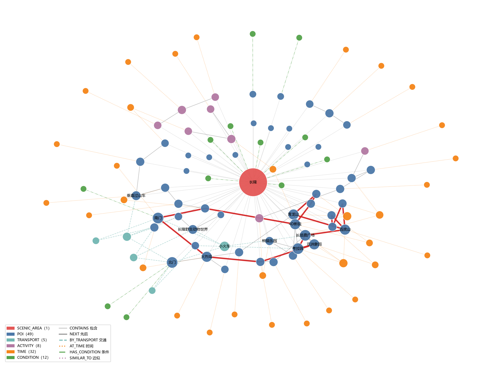
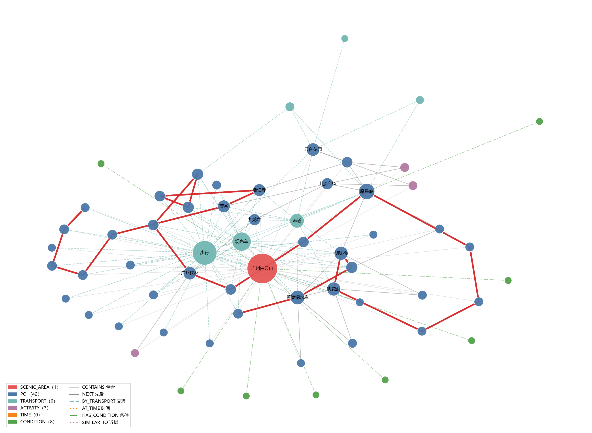
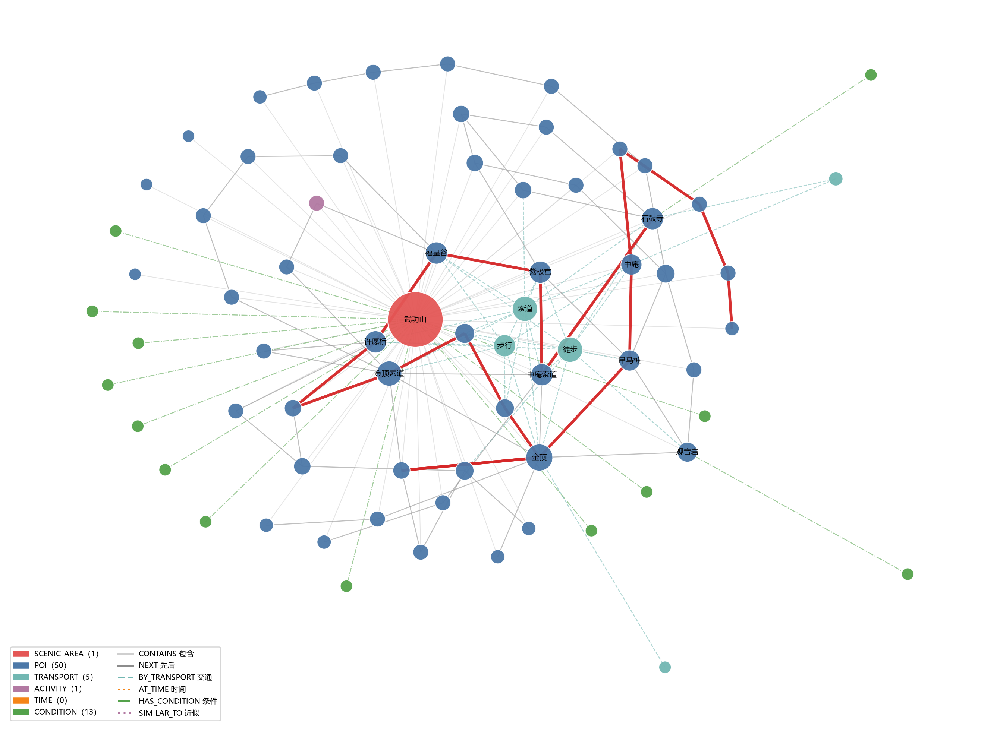
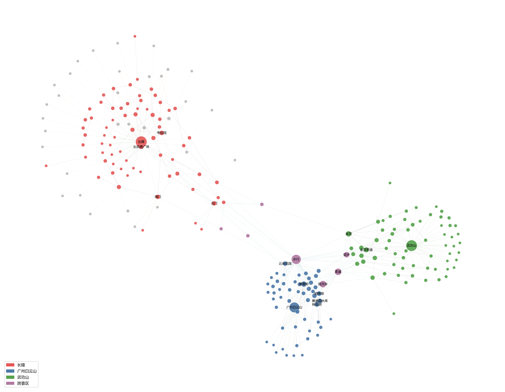

# P6 图谱质量验证与查询手册（graph_qa.md）

> 自动生成：`analysis/p06_graph/src/build_graph.py`｜时间：2026-11-01T14:16:57
> 输入：P2 `v0.2-p02`、P3 `v0.3-p03`、P5 `v0.5-p05`（只读）
> 覆盖景区：长隆、广州白云山、武功山

## 1. 规模

- 节点 **229**：SCENIC_AREA 3、POI 141、TRANSPORT 8、ACTIVITY 12、TIME 32、CONDITION 33
- 边 **523**：CONTAINS 153、NEXT 165、BY_TRANSPORT 118、AT_TIME 47、HAS_CONDITION 33、SIMILAR_TO 7
- 条件记录 36 条，其中 P5 建议入图 **33** 条（桥接 `recommended_for_graph=True`；3 条重复记录默认过滤）

## 2. 连通性

- 最大连通分量 **229/229（100.0%）**；分量大小 [229]
- 各景区节点数：长隆 71、广州白云山 54、武功山 65
- **去掉跨景区共享节点后**，各景区内部最大分量：长隆 71、广州白云山 54、武功山 65
- **反证**：若去掉跨景区共享的 `TRANSPORT` 节点，最大分量降为 103/229（45.0%），三个景区会分裂成各自子图——这正是共享交通节点存在的理由。

> 说明：三景区能连成一张网，靠的是 `TRANSPORT` 节点按**方式**跨景区共享（如 `TRANSPORT|步行` 同时挂在长隆、白云山、武功山的 POI 上）。这是**概念层共享**，表示"到这些景点可以步行"，**不代表景区之间可以步行互通**。图谱是知识网络，不是路网。

## 3. 融合规则与命中（为什么合并 / 为什么保留）

| 规则 | 说明 | 命中 |
|---|---|---|
| R1 同名合并 | 同景区内 P2 `normalized_name` 与 P3 `poi` 完全相同 | 54 对 |
| R2 别名表 | P3 `config/alias.csv` 归一后再比 | 0 对 |
| R3 交通归一 | `游览观光车→观光车`、`免费巴士/大巴/公交→巴士`、`地铁N号线→地铁` | 8 个规范名（原始 15 个写法） |
| R4 父子/层级不合并 | 如 `摩星岭` vs `摩星岭景区`，保留双节点 + SIMILAR_TO | 7 对 |
| P2 独有 | 只在实体识别里出现、不在任何路线步骤里 | 28 个 |
| P3 独有 | 只在路线里出现、P2 未识别 | 59 个 |

> R2 实测命中 **0 对**：P2 的 `normalized_name` 已是规范写法，P3 的 `poi` 也已按 `alias.csv` 归一，两侧没有需要靠别名才对上的名字。规则保留，命中数如实记 0。

R4 保留双节点的明细（`SIMILAR_TO`）：

- `POI|广州白云山|摩星岭` ↔ `POI|广州白云山|摩星岭景区`：层级写法：景区 vs 主峰
- `POI|广州白云山|明珠楼` ↔ `POI|广州白云山|明珠楼景区`：层级写法：景区 vs 楼
- `POI|广州白云山|鸣春谷` ↔ `POI|广州白云山|鸣春谷景区`：层级写法：景区 vs 谷
- `POI|广州白云山|山顶公园` ↔ `POI|广州白云山|山顶广场`：同一山顶片区的两种叫法
- `POI|广州白云山|云台景区` ↔ `POI|广州白云山|云台花园`：花园位于景区内
- `POI|广州白云山|麓湖景区` ↔ `POI|广州白云山|麓湖公园`：同一片区的两种叫法
- `POI|长隆|熊猫村` ↔ `POI|长隆|长隆大熊猫中心`：同一游览对象的不同命名，待人工确认

## 4. 核心节点（按无向度）

| 节点 | 类型 | 度 | 说明 |
|---|---|---|---|
| `SCENIC_AREA|长隆` | SCENIC_AREA | 64 | 长隆 |
| `SCENIC_AREA|武功山` | SCENIC_AREA | 62 | 武功山 |
| `SCENIC_AREA|广州白云山` | SCENIC_AREA | 52 | 广州白云山 |
| `TRANSPORT|步行` | TRANSPORT | 45 | 步行 |
| `TRANSPORT|索道` | TRANSPORT | 21 | 索道 |
| `TRANSPORT|观光车` | TRANSPORT | 21 | 观光车 |
| `POI|广州白云山|摩星岭` | POI | 14 | 摩星岭 |
| `TRANSPORT|徒步` | TRANSPORT | 14 | 徒步 |
| `POI|武功山|金顶` | POI | 13 | 金顶 |
| `POI|武功山|金顶索道` | POI | 11 | 金顶索道 |

## 5. 缺失的关系（缺失 ≠ 没有）

- **AT_TIME 只在长隆**：P3 显式时间 47 步、32 个时间值，按景区分布 {'长隆': 47}。白云山、武功山没有显式时间，**不推断、不补**。
- **P2/P3 对齐**：P3 的 POI 中约一半在 P2 找不到同名字面，已保留为独立 POI 节点，不硬合并；P2 独有 POI 只挂 `CONTAINS`，没有 `NEXT`/`BY_TRANSPORT`。
- **P5 条件覆盖**：只有 13/28 篇文档抽出条件，没有条件边的景区/POI 不代表"无条件"。
- **BY_TRANSPORT 只认同句共现**：同一段落但不同句的交通方式不连，避免把"全文提到索道"错误挂到每个 POI 上。

## 6. 可执行查询（复制即可跑）

```python
import pandas as pd, networkx as nx
nodes = pd.read_csv('analysis/p06_graph/outputs/graph_nodes.csv', encoding='utf-8-sig')
edges = pd.read_csv('analysis/p06_graph/outputs/graph_edges.csv', encoding='utf-8-sig')
G = nx.from_pandas_edgelist(edges, 'src', 'dst', edge_attr=['rel', 'weight'],
                            create_using=nx.MultiDiGraph)

# Q1 长隆有哪些 POI（P7 场景："长隆有什么好玩的"）
print(nodes.query("node_type=='POI' and scenic_area=='长隆'").name.tolist())

# Q2 从长隆北门出发的下一步（P7 场景：路线顺序）
print(edges.query("src=='POI|长隆|北门' and rel=='NEXT'"))

# Q3 哪些景点可以坐索道到（跨景区，P7 场景：交通方式）
print(edges.query("dst=='TRANSPORT|索道' and rel=='BY_TRANSPORT'").src.tolist())

# Q4 某个景区的条件建议（P7 场景：带老人/小孩怎么办）
print(edges.query("src=='SCENIC_AREA|武功山' and rel=='HAS_CONDITION'"))
```

## 7. 数据质量问题与处理

- **P3 伪 POI 15 条**：
  - 过滤 4 条（句子片段/动作）：`南门下山`、`完玻璃栈道就可以下山了`、`明月山景区大门终点`、`此次我们挑战经典的武功山沈明线`
  - 转 ACTIVITY 5 条：`刺激项目黄金时段→刺激项目`、`错峰午餐→错峰午餐`、`沉浸体验→沉浸体验`、`午餐休息区→午餐休息`、`夜场演出→夜场演出`
  - 保留 6 条并注明：`安检入口`、`明月山6281梯`、`羊狮慕小火车站`、`家庭亲子区`、`巡游主街段`、`欢乐主街区`
- **无 POI 的步骤 7 个**（不含 12 条"整篇路线概述"散文路线）：有活动名的建成 ACTIVITY 节点，只有概述的直接跳过。
- **条件目标缺失 0 条**：无（缺失时回退到景区节点）
- **CRLF/BOM**：输出 CSV 一律 UTF-8-SIG + `lineterminator='\n'`，JSONL/GraphML 为 UTF-8。

## 8. 给 P7 的接口

- 只读 `outputs/graph_nodes.csv`、`outputs/graph_edges.csv`；`node_id` 稳定，`POI|<景区>|<标准名>` 与 P5 桥接键一致。
- 条件节点的 id 是 `CONDITION|<cond_id>`，挂载方向 `POI/SCENIC_AREA -> CONDITION`。
- `TRANSPORT` 节点是**跨景区共享**的，`scenic_area` 可能是 `跨景区`；按景区过滤时请把 `跨景区` 一起带上，否则会漏掉交通方式。
- `TIME` 节点没有 `scenic_area`（时间值是跨景区概念），需要按边反查所属 POI。

## 9. 图

> 图内不写标题（标题由图题承担）；中文用 `C:\Windows\Fonts\msyh.ttc`。



*图 · 长隆知识图谱（红线为该景区步数最多的路线）*



*图 · 广州白云山知识图谱（红线为该景区步数最多的路线）*



*图 · 武功山知识图谱（红线为该景区步数最多的路线）*



*图 · 三景区知识图谱总览（颜色区分景区；共享的交通/时间节点连接三个景区）*
